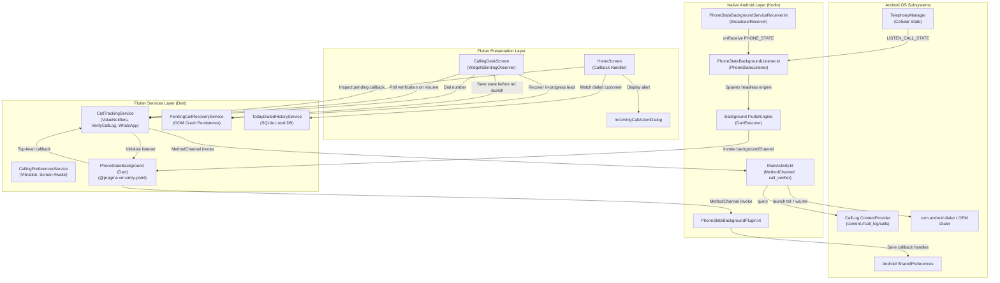
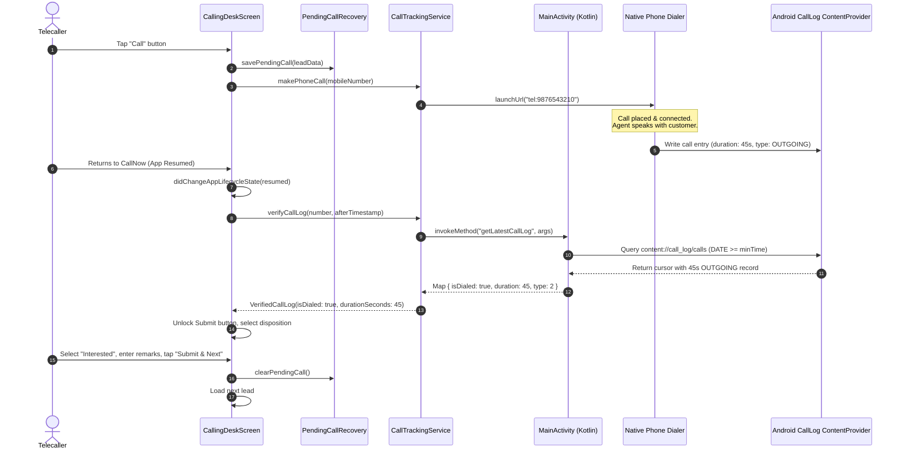
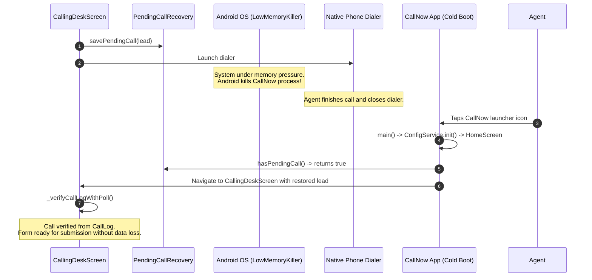
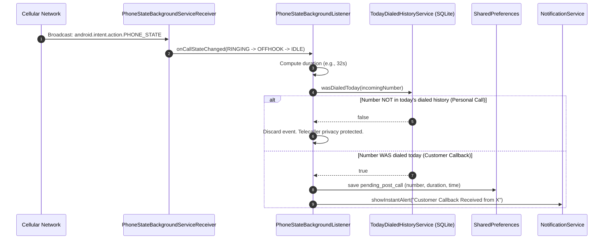

# Comprehensive Study Guide: Native Calling Engine Architecture

> **Target Project:** `CallNow` (`callnowMobileApp`)  
> **Platform:** Flutter (Dart) + Native Android (Kotlin)  
> **Target Audience:** Mobile Engineers, Architecture Students, Telephony System Developers  
> **Document Purpose:** In-depth technical breakdown of how the native calling engine handles phone call initiation, real-time telephony state tracking, call log verification, OS lifecycle resilience, OEM clock-skew & latency compensation, and telecaller privacy isolation.

---

## Table of Contents
1. [Architectural Overview & Design Philosophy](#1-architectural-overview--design-philosophy)
2. [High-Level System Architecture Diagram](#2-high-level-system-architecture-diagram)
3. [Component Deep-Dive: Native Android Layer (Kotlin)](#3-component-deep-dive-native-android-layer-kotlin)
   - [3.1 Host Activity & MethodChannel Bridge (`MainActivity.kt`)](#31-host-activity--methodchannel-bridge-mainactivitykt)
   - [3.2 Android CallLog ContentProvider Querying & Anti-Cheat Engine](#32-android-calllog-contentprovider-querying--anti-cheat-engine)
   - [3.3 Headless Telephony Engine (`packages/phone_state_background`)](#33-headless-telephony-engine-packagesphone_state_background)
4. [Component Deep-Dive: Flutter / Dart Layer](#4-component-deep-dive-flutter--dart-layer)
   - [4.1 Service Orchestration (`call_tracking_service.dart`)](#41-service-orchestration-call_tracking_servicedart)
   - [4.2 Calling Desk UI & Lifecycle State Machine (`calling_desk_screen.dart`)](#42-calling-desk-ui--lifecycle-state-machine-calling_desk_screendart)
   - [4.3 Progressive Polling & OEM Latency Compensation](#43-progressive-polling--oem-latency-compensation)
   - [4.4 OOM Cold-Restart Recovery (`pending_call_recovery_service.dart`)](#44-oom-cold-restart-recovery-pending_call_recovery_servicedart)
   - [4.5 Local SQLite Cache & Privacy Guard (`today_dialed_history_service.dart`)](#45-local-sqlite-cache--privacy-guard-today_dialed_history_servicedart)
5. [End-to-End Execution Flows](#5-end-to-end-execution-flows)
   - [5.1 Outgoing Lead Call Workflow (Desk -> Dialer -> Verification -> Disposition)](#51-outgoing-lead-call-workflow)
   - [5.2 Outgoing Call Surviving Process Kill (Low-RAM Device OOM)](#52-outgoing-call-surviving-process-kill)
   - [5.3 Incoming Customer Callback Detection & Discarding Personal Calls](#53-incoming-customer-callback-detection--privacy-filtering)
6. [Android OS & OEM Quirks Hardening](#6-android-os--oem-quirks-hardening)
7. [Security, Privacy & Permission Manifest Reference](#7-security-privacy--permission-manifest-reference)
8. [Quick Reference Cheat-Sheet](#8-quick-reference-cheat-sheet)

---

## 1. Architectural Overview & Design Philosophy

`CallNow` is a telecalling and CRM workflow management mobile app. In high-velocity outbound calling, sales agents dial dozens or hundreds of leads every day. The native calling engine is designed to solve five critical challenges:

1. **Anti-Cheat Verification:** Telecallers must actually place calls to submit lead dispositions. The system queries the Android OS `CallLog` directly to verify call occurrence and exact duration before unlocking submission.
2. **Real-time Telephony State Detection:** The app listens to cellular radio state transitions (`RINGING`, `OFFHOOK`, `IDLE`) in both foreground and background.
3. **Out-of-Memory (OOM) Resilience:** On budget and low-RAM devices (2GB–4GB RAM), opening the native system dialer often causes Android to kill the background Flutter activity. The engine persists call state across process destruction and cold boots.
4. **OEM Asynchronous Latency & Clock Skew:** Custom Android forks (Xiaomi MIUI/HyperOS, Oppo/Realme ColorOS, Vivo OriginOS, Samsung OneUI) delay writing call records to `CallLog.Calls` by 500ms–5000ms and exhibit clock discrepancies. The engine uses progressive generational polling and clock-skew buffers.
5. **Agent Privacy Isolation:** Telecallers often use personal devices. The engine strictly verifies incoming calls against a local SQLite database of numbers dialed today. Personal calls from friends and family are never captured, alerted, or uploaded to the CRM.

---

## 2. High-Level System Architecture Diagram



---

## 3. Component Deep-Dive: Native Android Layer (Kotlin)

### 3.1 Host Activity & MethodChannel Bridge (`MainActivity.kt`)

File: `android/app/src/main/kotlin/com/example/callnow_new/MainActivity.kt`  
Channel ID: `"com.example.callnow/call_verifier"`

`MainActivity` extends `FlutterActivity` and registers a dedicated `MethodChannel` to execute synchronous queries directly against Android OS system services.

#### Registered Methods:
1. `getLatestCallLog`: Queries `CallLog.Calls` for a specific phone number within a given time window.
2. `getRecentCallLogs`: Queries the top `N` recent call logs (incoming/outgoing/missed) for post-call recovery.
3. `checkCallLogPermission`: Returns whether `Manifest.permission.READ_CALL_LOG` is granted.
4. `openWhatsApp`: Directly launches WhatsApp (`com.whatsapp`) or WhatsApp Business (`com.whatsapp.w4b`) via Android intent.
5. `openAppSettings`: Launches the application details settings screen (`Settings.ACTION_APPLICATION_DETAILS_SETTINGS`).

---

### 3.2 Android CallLog ContentProvider Querying & Anti-Cheat Engine

The `queryCallLog` method in `MainActivity.kt` performs phone number matching and call validation:

```kotlin
private fun queryCallLog(targetNumber: String, afterTimestamp: Long): Map<String, Any?>
```

#### Step 1: Permission Gate
Checks `ContextCompat.checkSelfPermission(this, Manifest.permission.READ_CALL_LOG)`. If denied, it immediately returns `isDialed: false` with error `"PERMISSION_DENIED"`.

#### Step 2: Strict Normalization
Phone numbers across carriers and dialers vary (e.g., `+91 98765 43210`, `09876543210`, `9876543210`).
- Strips all non-digit characters: `val cleanTarget = targetNumber.replace(Regex("[^0-9]"), "")`
- Extracts the standard last 10 digits:
  ```kotlin
  val last10Target = if (cleanTarget.length >= 10) cleanTarget.takeLast(10) else cleanTarget
  ```

#### Step 3: Clock Skew Buffer & Query Selection
Android system time and telephony provider timestamps can diverge due to NTP adjustments or OEM clock drift.
- If `afterTimestamp > 0L`, the query sets a **60-second clock skew buffer**:
  ```kotlin
  val minTimestamp = afterTimestamp - 60_000L
  ```
- If `afterTimestamp == 0L`, it defaults to looking within the last 15 minutes.
- Selection statement:
  ```kotlin
  val selection = "${CallLog.Calls.DATE} >= ?"
  val selectionArgs = arrayOf(minTimestamp.toString())
  val sortOrder = "${CallLog.Calls.DATE} DESC"
  ```

#### Step 4: Outgoing Call Verification & False-Positive Elimination
In telecalling, a major bug occurs if an incoming call from a customer is counted as an outgoing call dialed by the agent. `MainActivity.kt` eliminates false positives:

```kotlin
// Explicitly exclude non-outgoing calls
val isIncomingOrMissed = callType == CallLog.Calls.INCOMING_TYPE ||
        callType == CallLog.Calls.MISSED_TYPE ||
        callType == CallLog.Calls.VOICEMAIL_TYPE ||
        callType == CallLog.Calls.REJECTED_TYPE ||
        callType == CallLog.Calls.BLOCKED_TYPE ||
        (android.os.Build.VERSION.SDK_INT >= android.os.Build.VERSION_CODES.N &&
         callType == CallLog.Calls.ANSWERED_EXTERNALLY_TYPE)

val isOutgoingOrAttempt = (callType == CallLog.Calls.OUTGOING_TYPE) ||
        (!isIncomingOrMissed && (duration > 0 || callType > 0))
```

If a record matches the last 10 digits and satisfies `isOutgoingOrAttempt`, the engine returns:
- `isDialed`: `true`
- `duration`: Call duration in seconds (from cellular network billing timer)
- `timestamp`: Call timestamp in epoch milliseconds
- `type`: Native CallLog type integer

#### Step 5: Android 11+ (API 30+) Query Builder Limitation
In `queryRecentCallLogs`, older Android code used `"${CallLog.Calls.DATE} DESC LIMIT 15"`. Android 11+ strictly validates query clauses and throws an `IllegalArgumentException` if SQL syntax keywords like `LIMIT` appear in `sortOrder`. `MainActivity.kt` fixes this by setting `sortOrder = "${CallLog.Calls.DATE} DESC"` and truncating results in the cursor loop:
```kotlin
do {
    // ... parse call record ...
    resultList.add(mapOf(...))
} while (cursor.moveToNext() && resultList.size < limit)
```

---

### 3.3 Headless Telephony Engine (`packages/phone_state_background`)

File Location: `packages/phone_state_background/android/src/main/kotlin/me/sodipto/phone_state_background/`

This embedded plugin executes background call tracking using a headless Dart executor.

#### Core Files:
1. **`PhoneStateBackgroundPlugin.kt`**:
   - Manages Flutter lifecycle (`FlutterPlugin`, `ActivityAware`).
   - Persists Dart callback handles (`toRawHandle()`) to Android `SharedPreferences`:
     - `phoneStateBackgroundPluginCallbackHandler` (the plugin dispatcher handle)
     - `phoneStateBackgroundCallbackHandlerUser` (the application user callback handle)
   - Toggles `PhoneStateBackgroundServiceReceiver` state via `PackageManager.setComponentEnabledSetting`.
2. **`PhoneStateBackgroundServiceReceiver.kt`**:
   - Registered in `AndroidManifest.xml` with intent filter `android.intent.action.PHONE_STATE`.
   - On receiving broadcast, initializes `FlutterLoader`, creates a singleton `PhoneStateBackgroundListener`, and subscribes to `TelephonyManager.listen(..., PhoneStateListener.LISTEN_CALL_STATE)`.
3. **`PhoneStateBackgroundListener.kt`**:
   - Extends Android's `PhoneStateListener`.
   - Maintains state machine:
     ```
     CALL_STATE_RINGING  --> Phone ringing (incoming call detected)
     CALL_STATE_OFFHOOK  --> Call answered OR outgoing call initiated
     CALL_STATE_IDLE     --> Call terminated / call disconnected
     ```
   - **Direction Disambiguation:**
     - If `OFFHOOK` occurs without prior `RINGING`, `callType` is classified as `OUTGOING`.
     - If `RINGING` precedes `OFFHOOK`, `callType` is classified as `INCOMING`.
   - **Duration Computation:**
     - Measures time between `OFFHOOK` and `IDLE` using `Duration.between(time, ZonedDateTime.now())`.
   - **Headless Dart Engine Invocation:**
     - Reads the stored callback handle from `SharedPreferences`.
     - Uses `FlutterCallbackInformation.lookupCallbackInformation(callbackHandler)`.
     - Spawns `FlutterEngine(context)` and executes the Dart entry-point callback asynchronously via `sBackgroundFlutterEngine.dartExecutor.executeDartCallback(args)`.
     - Sends event name, duration, and phone number via `MethodChannel("me.sodipto.phone_state_background_listner")`.

---

## 4. Component Deep-Dive: Flutter / Dart Layer

### 4.1 Service Orchestration (`call_tracking_service.dart`)

File: `lib/services/call_tracking_service.dart`

`CallTrackingService` acts as the central hub bridging native MethodChannels, background isolate notifications, and Flutter UI widgets.

#### Background Callback Dispatcher:
```dart
@pragma('vm:entry-point')
Future<void> phoneStateBackgroundCallbackHandler(
  PhoneStateBackgroundEvent event,
  String number,
  int duration,
) async
```
> [!IMPORTANT]
> The `@pragma('vm:entry-point')` annotation is mandatory. In Flutter release mode (AOT compilation), the Dart compiler tree-shakes (removes) any function not directly referenced in the main isolate. Because this callback is invoked from a native background isolate, the pragma prevents the compiler from stripping it.

#### Key Functions in `CallTrackingService`:
- `makePhoneCall(String phoneNumber)`:
  - Formats number to URI `tel:<number>`.
  - Stamps `_lastDialTime = DateTime.now()`.
  - Invokes `launchUrl(uri, mode: LaunchMode.externalApplication)`.
- `verifyCallLog(String phoneNumber, {int? afterTimestamp})`:
  - Calls `_verifierChannel.invokeMethod('getLatestCallLog', ...)`.
  - Deserializes into a type-safe `VerifiedCallLog` object.
- `markCallEnded(String number, int duration)`:
  - Classifies call into a timing tier:
    - `duration > 20`: `'CONNECTED_CONVERSATION'`
    - `0 < duration <= 20`: `'CONNECTED_SHORT'`
    - `duration == 0`: `'NOT_CONNECTED'`
  - Emits updates through `ValueNotifier<CallSessionEvent?> activeCallSession`.

---

### 4.2 Calling Desk UI & Lifecycle State Machine (`calling_desk_screen.dart`)

File: `lib/screens/calling_desk_screen.dart`

The Calling Desk is where telecallers dial leads sequentially. It implements `WidgetsBindingObserver` to track when the app transitions between foreground and background.

```
+--------------------------------------------------------+
| 1. User clicks "Call" button                           |
|    - Save lead in PendingCallRecoveryService           |
|    - Stamp dial time in CallTrackingService            |
|    - Launch external Android dialer (tel: URI)         |
+--------------------------------------------------------+
                           |
                           v
+--------------------------------------------------------+
| 2. App paused (AppLifecycleState.paused)               |
|    - Telecaller talks with customer in native dialer   |
+--------------------------------------------------------+
                           |
                           v
+--------------------------------------------------------+
| 3. App resumed (AppLifecycleState.resumed)             |
|    - didChangeAppLifecycleState() fires                |
|    - HapticFeedback triggered                          |
|    - Progressive retry polling started                 |
+--------------------------------------------------------+
                           |
                           v
+--------------------------------------------------------+
| 4. CallLog Verified (VerifiedCallLog.isDialed == true)  |
|    - If duration == 0: Pre-select 'RINGING'            |
|    - If 1s <= duration <= 18s: Mark Voicemail likely   |
|    - If duration > 18s: Pre-select 'NOT_INTERESTED'    |
|    - Unlock "Submit & Next" button                     |
+--------------------------------------------------------+
```

---

### 4.3 Progressive Polling & OEM Latency Compensation

Custom Android OEM operating systems (such as Xiaomi MIUI/HyperOS, Oppo/Realme ColorOS, Vivo OriginOS, and Samsung OneUI) run aggressive battery savers and asynchronous database flush operations. When a call ends:
1. The dialer UI closes immediately.
2. The user is brought back to `CallNow` (`AppLifecycleState.resumed`).
3. **The OEM CallLog provider has NOT finished writing the record to disk yet.**

If the app only queries `CallLog` once on resume, the query returns empty, causing a false negative ("Call not found").

#### The Solution: Generational Progressive Polling
In `calling_desk_screen.dart`:
```dart
void _pollCallLogOnResume() {
  _resumePollGeneration++;
  final currentGen = _resumePollGeneration;

  // 1. Immediately verify on resume
  _verifyCallWithAndroidLog();

  // 2. Progressive delays to catch asynchronous CallLog writes
  const delays = [1200, 2500, 4000, 6000];
  for (final ms in delays) {
    Future.delayed(Duration(milliseconds: ms), () {
      if (!mounted || currentGen != _resumePollGeneration) return;
      if (_verifiedCallLog == null || !_verifiedCallLog!.isDialed) {
        _verifyCallWithAndroidLog();
      }
    });
  }
}
```

- **Generational Guard (`_resumePollGeneration`):** If the user dials a new number before older polls complete, the generation counter increments, discarding stale responses from previous calls.
- **Progressive Fallback:** Checks at 0ms, 1200ms, 2500ms, 4000ms, and 6000ms. As soon as `_verifiedCallLog!.isDialed` is true, subsequent polls exit early.

---

### 4.4 OOM Cold-Restart Recovery (`pending_call_recovery_service.dart`)

File: `lib/services/pending_call_recovery_service.dart`

#### The Problem:
On budget Android devices (common in telecalling centers), launching the native dialer app consumes significant RAM. The Android OS `ActivityManager` frequently kills the background `CallNow` process (`LowMemoryKiller`). When the telecaller hangs up and returns, the app **cold-boots from scratch**, losing all in-memory lead state.

#### The Architecture:
1. **Before Launching Dialer:**
   ```dart
   await PendingCallRecoveryService.savePendingCall(lead);
   ```
   Serializes the full lead JSON and current timestamp into Android `SharedPreferences`.
2. **On App Boot / Cold Start (`HomeScreen` & `CallingDeskScreen`):**
   ```dart
   final pending = await PendingCallRecoveryService.getPendingCall();
   ```
   - Checks if a lead was dialed within `maxPendingAge` (4 hours).
   - If found, `CallingDeskScreen` restores the lead, runs `verifyCallLog()` against the native call log, and presents the telecaller with the post-call disposition form.
3. **After Successful CRM Submission:**
   ```dart
   await PendingCallRecoveryService.clearPendingCall();
   ```
   Clears storage so subsequent sessions start fresh.

---

### 4.5 Local SQLite Cache & Privacy Guard (`today_dialed_history_service.dart`)

File: `lib/services/today_dialed_history_service.dart`

#### Privacy Guard for Personal Calls:
Telecallers frequently use their personal smartphones. If an agent receives an incoming call from their family or bank while working, the app **must never** log, record, or sync that call.

#### The Dual-Check Mechanism:
1. Whenever a telecaller places an outbound call to a lead, the lead's last 10 digits are saved into a local SQLite table (`today_dialed_calls`).
2. When the background engine receives an `INCOMINGEND` event:
   ```dart
   final wasDialed = await TodayDialedHistoryService.instance.wasDialedToday(number);
   if (wasDialed) {
     // Legitimate customer callback!
     // Save pending post-call prompt and trigger high-priority notification.
   } else {
     // Personal call! Silently ignored and dropped.
   }
   ```
3. When `HomeScreen` checks recent incoming logs:
   ```dart
   final dialedLead = await TodayDialedHistoryService.instance.findDialedCall(cleanLast10);
   if (dialedLead == null) {
     await CallTrackingService.clearPendingPostCall();
     return; // Silently discard non-lead call
   }
   ```

---

## 5. End-to-End Execution Flows

### 5.1 Outgoing Lead Call Workflow



---

### 5.2 Outgoing Call Surviving Process Kill



---

### 5.3 Incoming Customer Callback Detection & Privacy Filtering



---

## 6. Android OS & OEM Quirks Hardening

| Quirk / Restriction | Manifestation | Engine Defense Mechanism |
|---|---|---|
| **Android 11+ API 30+ SQLite `LIMIT` Syntax Restriction** | Queries containing `"DATE DESC LIMIT 15"` throw `IllegalArgumentException`. | Sort string is strictly `"DATE DESC"`. Results are capped to `limit` directly in cursor iteration. |
| **Android 10+ Restricted `READ_CALL_LOG`** | Google Play classifies Call Log as a high-risk restricted permission. | Granular permission inspection in `PermissionService`. UI degrades gracefully to best-effort if denied. |
| **OEM Database Flush Latency (MIUI / ColorOS / Vivo)** | Call record is not written to SQLite immediately when dialer closes. | Progressive polling delays `[0ms, 1200ms, 2500ms, 4000ms, 6000ms]` with generational guard. |
| **System Clock Skew / NTP Adjustment** | Phone timestamp doesn't match content provider timestamp. | Automatic 60-second negative buffer: `val minTimestamp = afterTimestamp - 60_000L`. |
| **Low-RAM Process Termination (LMK)** | Background Flutter app is terminated while user is on dialer. | `PendingCallRecoveryService` stores active session in disk `SharedPreferences` before dialing. |
| **Incoming Call False-Positives** | Customer calls back agent; app might count it as dialed outgoing. | Strict query filter explicitly excluding `INCOMING_TYPE`, `MISSED_TYPE`, `REJECTED_TYPE`, `BLOCKED_TYPE`. |
| **Number Format Discrepancies** | Phone numbers have `+91`, `0`, spaces, or dashes. | Normalized to standard clean last 10 digits (`clean.takeLast(10)`). |
| **Dual-Engine Memory Leaks** | Headless engine from background listener spawning multiple instances. | Single background engine cached as singleton in `PhoneStateBackgroundListener.kt`. |

---

## 7. Security, Privacy & Permission Manifest Reference

### Android Permissions Declared in `android/app/src/main/AndroidManifest.xml`:

```xml
<!-- Cellular Radio & Call State -->
<uses-permission android:name="android.permission.INTERNET" />
<uses-permission android:name="android.permission.READ_PHONE_STATE" />
<uses-permission android:name="android.permission.READ_CALL_LOG" />
<uses-permission android:name="android.permission.CALL_PHONE" />
<uses-permission android:name="android.permission.FOREGROUND_SERVICE" />
<uses-permission android:name="android.permission.FOREGROUND_SERVICE_PHONE_CALL" />

<!-- Notifications (Android 13+ Tiramisu) -->
<uses-permission android:name="android.permission.POST_NOTIFICATIONS" />
<uses-permission android:name="android.permission.VIBRATE" />
<uses-permission android:name="android.permission.RECEIVE_BOOT_COMPLETED" />

<!-- Package Queries (Android 11+ API 30 Visibility) -->
<queries>
    <package android:name="com.whatsapp.w4b" />
    <package android:name="com.whatsapp" />
    <intent>
        <action android:name="android.intent.action.DIAL" />
        <data android:scheme="tel" />
    </intent>
</queries>
```

---

## 8. Quick Reference Cheat-Sheet

| Component | Technology | Primary File Path | Responsibility |
|---|---|---|---|
| **Call Verifier** | Kotlin / MethodChannel | `android/app/src/main/kotlin/com/example/callnow_new/MainActivity.kt` | Direct ContentProvider queries for call logs, WhatsApp intents, permission checks. |
| **Background Plugin** | Kotlin / FlutterPlugin | `packages/phone_state_background/android/.../PhoneStateBackgroundPlugin.kt` | Registers plugin, stores callback handles in SharedPreferences, toggles receiver. |
| **Service Receiver** | Android BroadcastReceiver | `packages/phone_state_background/android/.../PhoneStateBackgroundServiceReceiver.kt` | Catches `android.intent.action.PHONE_STATE` broadcasts and attaches listener. |
| **State Listener** | Telephony PhoneStateListener | `packages/phone_state_background/android/.../PhoneStateBackgroundListener.kt` | Tracks `IDLE`, `RINGING`, `OFFHOOK`, spawns headless `FlutterEngine`, computes duration. |
| **Call Tracking Service** | Flutter / Dart | `lib/services/call_tracking_service.dart` | MethodChannel caller, background isolate callback dispatcher, timing tiers classifier. |
| **Calling Desk** | Flutter UI / Lifecycle | `lib/screens/calling_desk_screen.dart` | Initiates dialer, handles app resume, executes generational progressive polling. |
| **Pending Call Recovery** | Flutter / SharedPreferences | `lib/services/pending_call_recovery_service.dart` | Serializes in-progress call to disk to survive low-RAM OS process termination. |
| **Today Dialed History** | Flutter / SQLite | `lib/services/today_dialed_history_service.dart` | Maintains local database of today's dialed leads; enforces privacy isolation for personal calls. |
| **Preferences Service** | Flutter / HapticFeedback | `lib/services/calling_preferences_service.dart` | Manages call-end vibration, screen awake locks, and preferred dialer modes. |

---

*Document compiled for engineering study and onboarding.*
